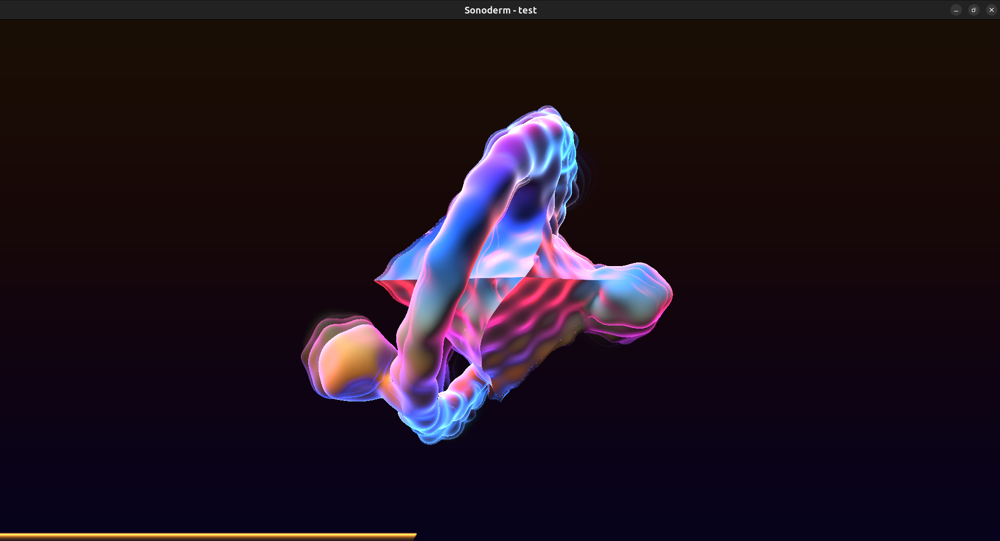

# Sonoderm

**Sonoderm** is a real-time, audio-reactive music visualizer built in modern *C++17* and *OpenGL 3.3 Core*. It generates a deterministic, lite living 3D world for every audio track using *Signed Distance Fields (SDF), Raymarching, Fast Fourier Transform (FFT) analysis,* and *temporal feedback memory.*

## Showcase



*Screenshot of Sonoderm ran in real-time: reacting a to music played, using a raymarched geometry with a cosine palette, and displaying a bottom progress line.*

## Features

- **Procedural 3D SDF Raymarching:** Renders volumetric shapes (spheres, rounded boxes, octahedrons, tori) without polygonal meshes.
- **Organic Liquid Fusion:** Blends distinct geometric primitives smoothly via polynomial `smin`.
- **Psychoacoustic Audio Engine:** Uses `miniaudio` with lock-free/thread-safe sample tapping.
- **In-House FFT & AGC:** Cooley-Tukey FFT with Hann windowing and Automatic Gain Control across Bass, Mid, and Treble.
- **Physical Inertia (`MotionBrain`):** Framerate-independent spring-damper filters and audio-driven time dilation (`u_audio_time`).
- **Deterministic Song DNA:** Generates a persistent visual universe (geometry, satellites, cosine color palette) unique to each audio file hash.
- **Temporal Feedback Memory:** Ping-pong FBO pipeline creating persistent light trails and shockwaves.
- **Ghost UI & Freeze State:** Embedded progress line at the viewport base; physical freeze/frost crystallization on pause.
- **Dynamic Resolution:** Responsive viewport handling window resizing and HiDPI displays without geometric distortion.

## Controls

- `SPACE`: Toggle Play / Pause (activates freeze/frost state)
- `ESC` / `Q`: Exit application
- Window Resize: Automatically adapts rendering resolution

## Prerequisites (Linux)

Install standard build tools, CMake, GLFW, and Mesa OpenGL development libraries (only tested on Ubuntu):

```bash
# Debian / Ubuntu
sudo apt update
sudo apt install build-essential cmake libglfw3-dev libgl1-mesa-dev

# Arch Linux
sudo pacman -S base-devel cmake glfw-x11 mesa

# Fedora
sudo dnf install gcc-c++ cmake glfw-devel mesa-libGL-devel
```

## Build and Run

```bash
mkdir build && cd build
cmake ..
cmake --build .
cd ..

# Run default track
./build/sonoderm assets/audio/shinning_star.mp3

# Run any custom track
./build/sonoderm /path/to/song.mp3
```

---

## Appendix: Core Concepts & References

Here are a few resources that I find very useful for grasping important concepts, if you haven’t already done so:

| Concept | Reference |
| :--- | :--- |
| **Signed Distance Fields (SDF)** | [Inigo Quilez - 3D Distance Functions](https://iquilezles.org/articles/distfunctions/) |
| **Raymarching (Sphere Tracing)** | [Jamie Wong - Ray Marching and Signed Distance Functions](https://jamie-wong.com/2016/07/15/ray-marching-signed-distance-functions/) |
| **Smooth Minimum (`smin`)** | [Inigo Quilez - Smooth Minimum](https://iquilezles.org/articles/smin/) |
| **Cosine Gradient Palettes** | [Inigo Quilez - Cosine Palettes](https://iquilezles.org/articles/palettes/) |
| **Automatic Gain Control (AGC)** | [Automatic Gain Control (Wikipedia)](https://en.wikipedia.org/wiki/Automatic_gain_control) |
| **Ping-Pong Framebuffer Objects (FBO)** | [LearnOpenGL - Framebuffers](https://learnopengl.com/Advanced-OpenGL/Framebuffers) |
| **FNV-1a Hash** | [Fowler-Noll-Vo Hash Function](https://en.wikipedia.org/wiki/Fowler%E2%80%93Noll%E2%80%93Vo_hash_function) |
| **Windowing** | [Spectral Leakage and Windowing Functions](https://en.wikipedia.org/wiki/Window_function) |
| **Fast Fourier Transform (FFT)** | [Cooley-Tukey FFT Algorithm (Wikipedia)](https://en.wikipedia.org/wiki/Cooley%E2%80%93Tukey_FFT_algorithm) |

*If you would like to delve deeper into the Fourier transform, you can check out this article written by my fellow friend [Igor MOGOU](https://github.com/IgorGreenIGM): [Deep Dive into Fourier Transform](https://igormogou86.wordpress.com/2025/04/27/deep-dive-into-fourier-transform)*